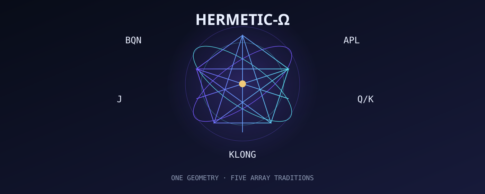
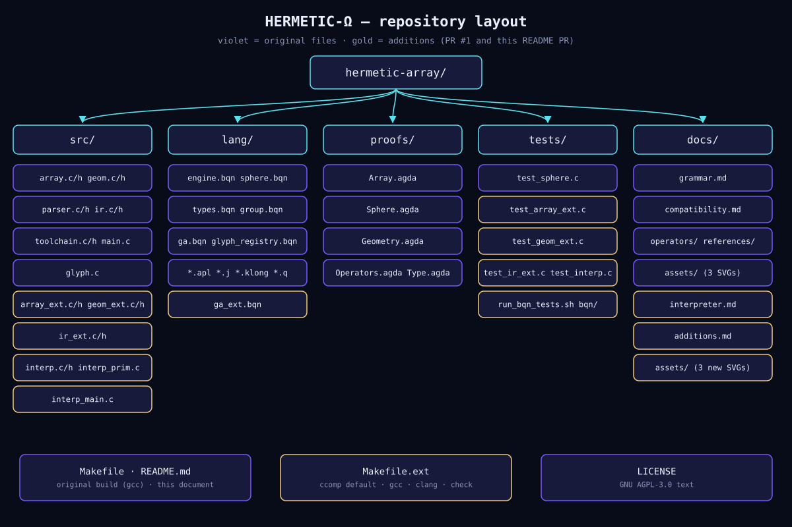
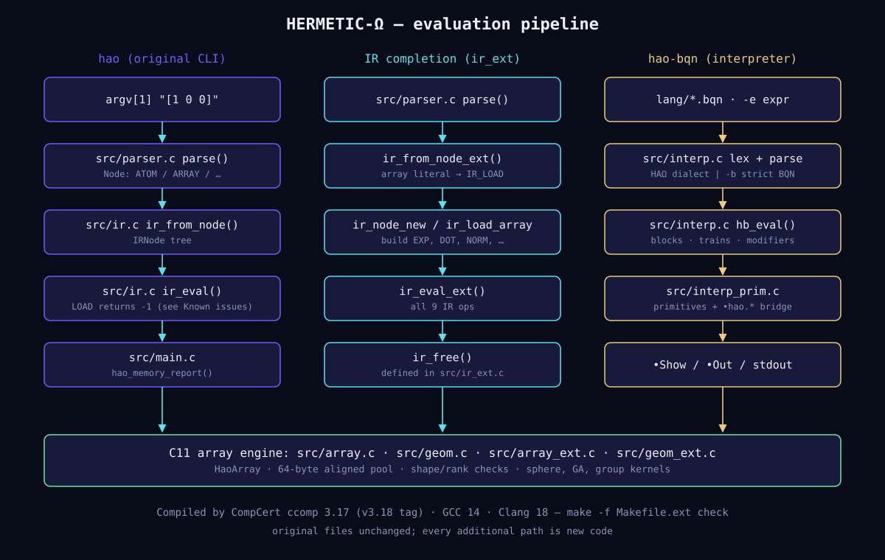
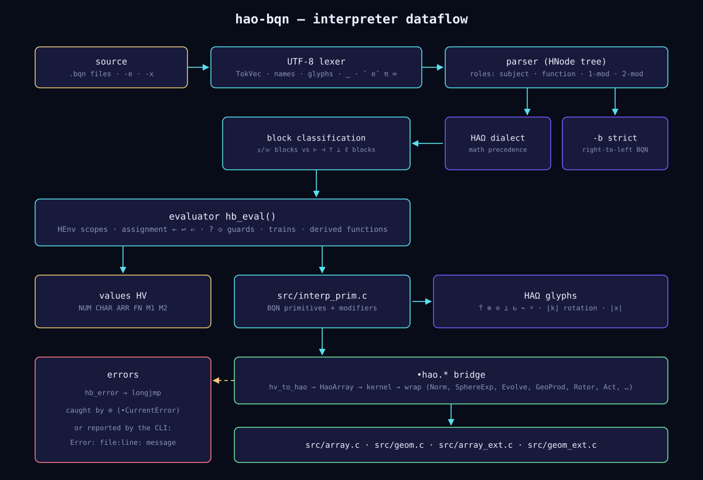

<!--
  HERMETIC-Ω (hermetic-array) · README.md
  SPDX-License-Identifier: LicenseRef-Sovereign-Leviathan-SL-AGPL3-001
  License-ID: SL-AGPL3-001 | Covenant-Version: 1.0
  Copyright (C) 2026 SnapKittyWest. Ahmad Ali Parr, Bel Esprit D'Accord Irrevocable Trust.
  Dual-licensed: GNU AGPL-3.0 (LICENSE) or the Sovereign Leviathan additional terms (LICENSE-SOVEREIGN-LEVIATHAN).
  Hark, though this node be but a spark,
  Its covenant endureth through the dark.
-->

<p align="center">
  
</p>
<h1 align="center">HERMETIC-Ω</h1>
<p align="center">A Unified Recursive Geometric Array Language</p>
<p align="center">BQN · APL · J · Q/K · Klong</p>
<p align="center">Pure Arrays. Geometric Algebra. Deterministic Transformation.</p>

<p align="center">
  <a href="https://github.com/AHMADALIPARR/hermetic-array/actions/workflows/ci.yml"></a>
  <a href="https://github.com/AHMADALIPARR/hermetic-array/actions/workflows/release.yml"></a>
  <a href="#19-license"></a>
  
  
  
  
</p>

HERMETIC-Ω (also styled HAΩ) is a research repository for one coherent
geometric array calculus that draws on BQN, APL, J, Q/K and Klong. Computation
is built from array transformations, group actions and manifold evolution,
avoiding dense matrix materialisation where possible. The repository contains:

- a C11 array engine with explicit ownership, bounds checks and a cache-aligned pool;
- pure array-language definitions of the same geometry;
- `hao-bqn`, a C11 interpreter that runs the BQN-style sources;
- Agda sketches of the invariants.

The C sources are compiled and tested with the CompCert verified C compiler.

This README describes the repository as it exists on `main`. Every command
shown below was run and its output is pasted as produced. Anything that is
only designed, not implemented, is labelled **Proposed**.

## Contents

1. [Status at a glance](#1-status-at-a-glance)
2. [Repository layout](#2-repository-layout)
3. [Mathematical foundations](#3-mathematical-foundations)
4. [Architecture](#4-architecture)
5. [C11 array engine (`src/`)](#5-c11-array-engine-src)
6. [The `hao-bqn` interpreter](#6-the-hao-bqn-interpreter)
7. [Array-language sources (`lang/`)](#7-array-language-sources-lang)
8. [Formal sketches (`proofs/`)](#8-formal-sketches-proofs)
9. [Building](#9-building)
10. [CompCert](#10-compcert)
11. [Tests](#11-tests)
12. [Continuous integration](#12-continuous-integration)
13. [Known issues in the original code](#13-known-issues-in-the-original-code)
14. [Limitations](#14-limitations)
15. [Design philosophy](#15-design-philosophy)
16. [Documentation index](#16-documentation-index)
17. [Glossary](#17-glossary)
18. [Credits](#18-credits)
19. [License](#19-license)

## 1. Status at a glance

| Area | State | Where |
|------|-------|-------|
| Array representation, pool allocator, memory accounting | Implemented | `src/array.c` |
| Sphere exponential map, geodesic, orthogonality checks | Implemented | `src/geom.c` |
| General array primitives (take, drop, join, reduce, scan, outer, matmul, grade, broadcast, …) | Implemented | `src/array_ext.c` |
| Sphere log / distance / transport, Cl(3,0) multivectors, rotors, group actions | Implemented | `src/geom_ext.c` |
| Parser for atoms and array literals | Implemented (minimal) | `src/parser.c` |
| IR: lowering and evaluation of all nine ops | Implemented | `src/ir_ext.c` (the original `src/ir.c` is partial) |
| Interpreter for the BQN-style sources | Implemented | `src/interp*.c`, binary `hao-bqn` |
| BQN, APL, J, Klong and Q definitions | Present; the BQN files run on `hao-bqn` | `lang/` |
| Agda formalisation | Sketches; they do not type-check (see §8) | `proofs/` |
| Compilation with CompCert | Verified: `make -f Makefile.ext check` passes | `Makefile.ext` |
| CI: GCC 14, Clang, ASan+UBSan, CBQN cross-check, CompCert | Passing on `main` | `.github/workflows/ci.yml` (§12) |
| Release packaging (binaries, source tarball, `SHA256SUMS`, both license files) | Releases are cut from `v*` tags; `v1.0.0` is the first. The dry run passes on pull requests | `.github/workflows/release.yml` (§12.2) |
| Licensing | Dual: GNU AGPL-3.0 or the Sovereign Leviathan additional terms (SL-AGPL3-001); every source and text file carries the SPDX header | `LICENSE`, `LICENSE-SOVEREIGN-LEVIATHAN` (§19) |
| Unified multi-language surface syntax and elaborator | **Proposed** | `docs/grammar.md` |
| Benchmarks | None claimed | — |

## 2. Repository layout

<p align="center"></p>

```text
hermetic-array/
├── Makefile                  original build of the hao CLI (gcc)
├── Makefile.ext              extended build: CompCert by default, gcc/clang, all tests
├── LICENSE                   GNU AGPL-3.0 text
├── LICENSE-SOVEREIGN-LEVIATHAN  Sovereign Leviathan additional terms (SL-AGPL3-001)
├── src/
│   ├── array.h / array.c     HaoArray, aligned pool, reshape/permute/rotate, inner/norm, sphere evolution
│   ├── geom.h / geom.c       norm², dot, sinc, sphere exp, orthogonality, geodesic, quaternions
│   ├── parser.h / parser.c   recursive-descent parser for atoms, glyphs and array literals
│   ├── ir.h / ir.c           IR op set (LOAD … EVOLVE) and the original partial evaluator
│   ├── toolchain.h / .c      string-named dispatcher onto the C kernels
│   ├── main.c                hao CLI: parse → IR → eval → memory report
│   ├── glyph.c               glyph registry table and glyph_lookup (not in either Makefile)
│   ├── array_ext.h / .c      general array primitives
│   ├── geom_ext.h / .c       sphere geometry, Euclidean transforms, Cl(3,0), rotors, group actions
│   ├── ir_ext.h / .c         ir_free, parser→IR lowering, complete IR evaluator
│   ├── interp.h / interp.c   hao-bqn lexer, parser, environments, evaluator
│   ├── interp_prim.c         primitives, modifiers, formatting, builtins, •hao.* bridge
│   └── interp_main.c         hao-bqn command line
├── lang/
│   ├── engine.bqn sphere.bqn types.bqn group.bqn ga.bqn glyph_registry.bqn
│   ├── ga_ext.bqn            Cross, GeoProd3, Exterior3 (completes ga.bqn without ⟕)
│   ├── engine.apl operators.apl group.apl tensor.apl
│   ├── engine.j recursion.j
│   ├── engine.klong evolution.klong recursion.klong
│   └── q_engine.q
├── proofs/                   Array.agda Sphere.agda Geometry.agda Operators.agda Type.agda
├── tests/
│   ├── test_sphere.c         original sphere-exp unit-norm test
│   ├── test_array_ext.c test_geom_ext.c test_ir_ext.c test_interp.c
│   ├── run_bqn_tests.sh      runs tests/bqn/*.bqn and compares with *.expected
│   └── bqn/                  10 BQN test files plus expected output
└── docs/
    ├── grammar.md compatibility.md README.md operators/ references/
    ├── interpreter.md        hao-bqn dialect and coverage
    ├── additions.md          what was missing and what was added
    ├── ASSET-CREDITS.md
    └── assets/               SVG diagrams
```

## 3. Mathematical foundations

Unit sphere:

```math
S^n = \{ x \in \mathbb{R}^{n+1} : \lVert x \rVert = 1 \}
```

HAΩ (`lang/sphere.bqn`) · C kernel `hao_is_unit(x, n, tol)`. The bars `|…|` are magnitude; `Norm` is the squared norm, so the test is $`\lVert x \rVert^2 = 1`$:

```bqn
Norm ← +´×˘

IsUnit ← {
  |Norm ℓ - 1| < 1e¯8
}
```

```console
$ bin-ccomp/hao-bqn lang/sphere.bqn -e 'IsUnit 1‿0‿0' -e 'IsUnit 2‿0‿0' -e 'IsTangent 1‿0‿0 0‿0.1‿0'
1
0
1
```

Sphere exponential map (`hao_sphere_exp` in `src/geom.c`, `SphereExp` in `lang/sphere.bqn` and `lang/engine.bqn`):

```math
\mathrm{Exp}_x(v) = \cos(\lVert v \rVert)\, x + \mathrm{sinc}(\lVert v \rVert)\, v
```

HAΩ (`lang/engine.bqn`) · C kernels `hao_sphere_exp`, `hao_array_sphere_exp` · bridge `•hao.SphereExp x v`. `⊢ ⊣` are the first and second arguments, `ℓ` the whole argument, `c ? a ◇ b` the conditional:

```bqn
Sinc ← {
  t ← ℓ
  ∣t∣ < 1e¯12 ? 1 - (t×t)÷6 ◇ (Sin t) ÷ t
}

SphereExp ← {
  x ← ⊢
  v ← ⊣
  nv ← √ Norm v
  c ← Cos nv
  s ← Sinc nv
  (c × x) + (s × v)
}
```

```console
$ bin-ccomp/hao-bqn lang/engine.bqn -e 'SphereExp 1‿0‿0 0‿0.1‿0' -e '•hao.SphereExp 1‿0‿0 0‿0.1‿0'
⟨ 0.9950041652780258 0.09983341664682815 0 ⟩
⟨ 0.9950041652780258 0.09983341664682815 0 ⟩
```

The zero case is continuous through the Taylor expansion of sinc. The preconditions are $`\lVert x \rVert = 1`$ and $`x \cdot v = 0`$.

Logarithm map and geodesic distance (`hao_sphere_log`, `hao_sphere_distance` in `src/geom_ext.c`):

```math
\mathrm{Log}_x(y) = \frac{\theta}{\sin\theta}\,(y - \cos\theta\, x), \qquad d(x,y) = \theta = \arccos(x \cdot y)
```

No `lang/*.bqn` definition; HAΩ reaches the C kernels `hao_sphere_log` and `hao_sphere_distance` through the bridge:

```console
$ bin-ccomp/hao-bqn -e '•hao.Log 1‿0‿0 0‿1‿0' -e '•hao.Distance 1‿0‿0 0‿1‿0'
⟨ 0 1.5707963267948966 0 ⟩
1.5707963267948966
```

Geodesic interpolation, i.e. slerp (`hao_geodesic`, `Geodesic` in `lang/engine.bqn`):

```math
\gamma(t) = \frac{\sin((1-t)\theta)}{\sin\theta}\,x + \frac{\sin(t\theta)}{\sin\theta}\,y
```

HAΩ (`lang/engine.bqn`) · glyph `x ⌁ y` = $`\gamma(\tfrac12)`$ · C kernel `hao_geodesic(x, y, t, out)` · bridge `•hao.Geodesic x y t`:

```bqn
Geodesic ← {
  x ← ⊢
  y ← ⊣
  t ← ⊤
  θ ← Arccos Dot x y
  s0 ← Sin ((1-t)×θ)
  s1 ← Sin (t×θ)
  ((s0×x) + (s1×y)) ÷ Sin θ
}
```

```console
$ bin-ccomp/hao-bqn lang/engine.bqn -e 'Geodesic 1‿0‿0 0‿1‿0 0.5' -e '1‿0‿0 ⌁ 0‿1‿0'
⟨ 0.7071067811865475 0.7071067811865475 0 ⟩
⟨ 0.7071067811865475 0.7071067811865475 0 ⟩
```

Special orthogonal group and orthogonal invariance:

```math
\mathrm{SO}(n) = \{ Q \in \mathbb{R}^{n \times n} : Q^T Q = I,\ \det Q = 1 \}, \qquad \lVert Qx \rVert^2 = \lVert x \rVert^2
```

HAΩ (`lang/group.bqn`) · glyph `⟂` (orthogonality) · C kernels `hao_is_special_orthogonal`, `hao_group_act_matrix` · bridge `•hao.IsSO`, `•hao.Act`. The rotation by 90° below keeps $`\lVert Qx \rVert`$ = 5:

```bqn
Act ← {
  g ← ⊢
  x ← ⊣
  g × x
}

Stabilizer ← {
  g ← ⊢
  x ← ⊣
  Act g x ≡ x
}
```

```console
$ bin-ccomp/hao-bqn lang/group.bqn -e 'r ← 2‿2⥊0‿¯1‿1‿0' -e '•hao.IsSO r' -e '•hao.Act r 3‿4' -e '•hao.Norm •hao.Act r 3‿4' -e 'Stabilizer 1 3‿4'
2‿2⥊⟨ 0 ¯1 1 0 ⟩
1
⟨ ¯4 3 ⟩
5
1
```

Recursive geometric state, where $`\Phi`$ is a pure function preserving declared invariants (unit norm, tangency, shape):

```math
G_{n+1} = \Phi(G_n), \qquad X_{n+1} = \mathrm{Exp}_{X_n}(\eta_n V_n)
```

HAΩ (`lang/engine.bqn`, fuel-bounded recursion with $`\eta_n = \eta`$ and $`V_n = v`$) · C kernel `hao_evolve_sphere(x, v, η, steps, out)` · bridge `•hao.Evolve x v η n`. Both reuse `v` unchanged at every step (see §13):

```bqn
Evolve ← {
  x ← ⊢
  v ← ⊣
  η ← ⊤
  n ← ⊥
  n = 0 ? x ◇ Evolve (SphereExp x (η×v)) v η (n-1)
}
```

```console
$ bin-ccomp/hao-bqn lang/engine.bqn -e 'Evolve 1‿0‿0 0‿0.05‿0 1 3' -e '•hao.Evolve 1‿0‿0 0‿0.05‿0 1 3'
⟨ 0.9962554647802354 0.1497502030301618 0 ⟩
⟨ 0.9962554647802354 0.1497502030301618 0 ⟩
```

Geometric product of vectors in Cl(3,0) (`hao_geometric_product3`, `hao_mv_product`):

```math
ab = a \cdot b + a \wedge b
```

HAΩ (`lang/ga_ext.bqn`) · glyph `a ⊙ b` · C kernels `hao_geometric_product3` → `[s e23 e31 e12]`, `hao_mv_product` (full Cl(3,0)). `⌊k⌋ v` rotates `v` by `k`, and `⌈` joins inside HAΩ blocks:

```bqn
Cross ← {
  a ← ⊢
  b ← ⊣
  # 3D cross product from cyclic rotations (dual of the wedge a∧b)
  (⌊1⌋ a × ⌊¯1⌋ b) - (⌊¯1⌋ a × ⌊1⌋ b)
}

GeoProd3 ← {
  a ← ⊢
  b ← ⊣
  s ← Dot a b
  # Scalar part then bivector part ⟨e23 e31 e12⟩
  cr ← Cross a b
  s ⌈ cr
}
```

```console
$ bin-ccomp/hao-bqn lang/engine.bqn lang/ga_ext.bqn -e 'GeoProd3 1‿0‿0 0‿1‿0' -e '1‿0‿0 ⊙ 0‿1‿0' -e 'Cross 1‿2‿3 4‿5‿6'
⟨ 0 0 0 1 ⟩
⟨ 0 0 0 1 ⟩
⟨ ¯3 6 ¯3 ⟩
```

The multivector basis order is bitmask order: $`1, e_1, e_2, e_{12}, e_3, e_{13}, e_{23}, e_{123}`$.

### Notation summary

| Formula | HAΩ notation | C kernel |
|---------|--------------|----------|
| $`S^n`$ membership | `IsUnit x` | `hao_is_unit` |
| $`\mathrm{Exp}_x(v)`$ | `SphereExp x v` | `hao_sphere_exp` |
| $`\mathrm{Log}_x(y)`$, $`d(x,y)`$ | `•hao.Log x y`, `•hao.Distance x y` | `hao_sphere_log`, `hao_sphere_distance` |
| $`\gamma(t)`$ | `Geodesic x y t`, `x ⌁ y` | `hao_geodesic` |
| $`Q \in \mathrm{SO}(n)`$, $`Qx`$ | `•hao.IsSO q`, `Act g x` | `hao_is_special_orthogonal`, `hao_group_act_matrix` |
| $`X_{n+1} = \mathrm{Exp}_{X_n}(\eta V)`$ | `Evolve x v η n` | `hao_evolve_sphere` |
| $`ab = a \cdot b + a \wedge b`$ | `GeoProd3 a b`, `a ⊙ b` | `hao_geometric_product3` |
| $`a \otimes b`$ | `a ⊗ b` | `hao_outer` |
| $`a \perp b`$ | `a ⟂ b` | `hao_inner` |
| reshape to shape $`s`$ | `s ⍡ x` | `hao_reshape` |
| rotate by $`k`$ | `k ↻ x`, `⌊k⌋ x` | `hao_rotate` |


The polygons are symbolic state representations only.

## 4. Architecture

<p align="center"></p>

There are three ways into the C11 engine:

| Path | Entry | Flow | State |
|------|-------|------|-------|
| `hao` (original) | `src/main.c` | `parse` → `ir_from_node` → `ir_eval` → memory report | builds; `ir_eval` returns −1 for array literals, so only the memory report prints |
| IR completion | `src/ir_ext.c` | `parse` → `ir_from_node_ext` → `ir_eval_ext` → `ir_free` | all nine IR ops evaluate; covered by `tests/test_ir_ext.c` |
| `hao-bqn` | `src/interp_main.c` | lex → parse → `hb_eval` → primitives / `•hao.*` → C kernels | runs every original `lang/*.bqn` file |

The original native-array architecture diagram:


The unified syntax shown at its top is still **Proposed**.

## 5. C11 array engine (`src/`)

All modules are C11 and depend only on libm. Functions that return `int`
report errors as codes. The original kernels return −1 for invalid input, −2
for length mismatches and −3 for a failed precondition. The `_ext` modules use
−1 for an invalid argument, −2 for length, −3 for domain and −4 for rank.

### 5.1 `src/array.h` / `src/array.c` — representation and core operations (original)

| Function / item | Purpose |
|-----------------|---------|
| `HaoArray` | element type (`HAO_SCALAR_F64`, `I64`, `BOOL`), rank, shape, strides, data, element count, ownership, bytes |
| `hao_pool_init`, `hao_pool_alloc`, `hao_pool_reset`, `hao_pool_free` | bump pool on `aligned_alloc` with 64-byte (`HAO_CACHE_LINE`) alignment |
| `hao_total_bytes`, `hao_peak_bytes`, `hao_alloc_count`, `hao_memory_report` | memory accounting, printed to stderr |
| `hao_array_create`, `hao_array_free`, `hao_array_element_size` | construction and release |
| `hao_array_ptr`, `hao_array_check_bounds` | bounds-checked element addressing |
| `hao_reshape` | reshape; returns NULL unless the element count matches exactly |
| `hao_permute_axes` | axis permutation (see §13) |
| `hao_rotate(a, axis, k, out)` | cyclic rotation along an axis |
| `hao_inner`, `hao_norm`, `hao_normalize` | 4-wide unrolled inner product, Euclidean norm, normalisation |
| `hao_evolve_sphere(x, v, η, steps, out)` | fuel-bounded sphere evolution with unit and tangency precondition checks |

### 5.2 `src/geom.h` / `src/geom.c` — geometric kernels (original)

| Function | Purpose |
|----------|---------|
| `hao_norm2`, `hao_dot` | squared norm and dot product over raw `double *` (4-wide) |
| `hao_sinc`, `hao_sphere_exp` | continuous sinc and the sphere exponential map |
| `hao_is_unit`, `hao_is_tangent`, `hao_is_orthogonal`, `hao_is_rotation` | predicates (`hao_is_rotation` checks orthogonality only) |
| `hao_array_sphere_exp` | array-level Exp with shape checks (used by `tests/test_sphere.c`) |
| `hao_geodesic(x, y, t, out)` | slerp between unit vectors |
| `hao_geometric_product`, `hao_exterior`, `hao_sandwich`, `hao_group_act` | early GA and group stubs (see §13) |
| `hao_quat_mul`, `hao_quat_rotate` | quaternion product and rotation |

### 5.3 `src/parser.h` / `src/parser.c` — parser (original)

`parse(const char *)` is a recursive-descent parser for numbers, glyphs and
nested array literals such as `[1 0 0]` and `[[1,2,3],[4,5,6]]`. It builds a
`Node` tree whose kinds are `NODE_ATOM`, `NODE_MONADIC`, `NODE_DYADIC`,
`NODE_TRAIN`, `NODE_ARRAY`, `NODE_SHAPE` and `NODE_GEO`. `node_free`
releases the tree.

### 5.4 `src/ir.h` / `src/ir.c` — IR (original)

The op set is `IR_LOAD`, `IR_STORE`, `IR_RESHAPE`, `IR_PERMUTE`, `IR_EXP`,
`IR_DOT`, `IR_NORM`, `IR_GEO_PROD` and `IR_EVOLVE`. `ir_from_node` and
`ir_eval` are partial (see §13). `ir_free` is declared here and defined in
`src/ir_ext.c`.

### 5.5 `src/toolchain.h` / `src/toolchain.c`, `src/main.c`, `src/glyph.c` (original)

| File | Contents |
|------|----------|
| `toolchain.c` | `hao_toolchain_eval(opname, x, v, η, steps, out)` maps `"evolve"`, `"norm"`, `"geoprod"` and `"act"` onto kernels; any other name is treated as sphere exp. `toolchain_main` is a fixed-input driver that nothing calls. |
| `main.c` | the `hao` CLI: 1 MiB pool → `parse(argv[1])` → `ir_from_node` → `ir_eval` → prints `ok rank=… count=…` on success → `hao_memory_report` |
| `glyph.c` | `GlyphEntry` registry (⊗ ∧ ∘ ⟂ ⊙ ↻ ⌁ ⍉ ⌽ ⍤ with origin, meaning, arity and shape rule) and `glyph_lookup`. It is not compiled by either Makefile. |

### 5.6 `src/array_ext.h` / `src/array_ext.c` — array primitives (addition)

| Group | Functions |
|-------|-----------|
| element access | `hao_get_f64`, `hao_set_f64`, `hao_array_copy`, `hao_from_f64` |
| structure | `hao_iota`, `hao_reverse(a, axis)`, `hao_transpose`, `hao_transpose_axes(a, perm)` (result axis *i* = source axis `perm[i]`), `hao_reshape_fill` (cyclic fill), `hao_take`, `hao_drop`, `hao_join`, `hao_broadcast` |
| arithmetic | `hao_map2` with `HaoBinOp` ADD/SUB/MUL/DIV/MAX/MIN/POW and broadcasting, `hao_scale`, `hao_reduce(a, axis, op)`, `hao_scan(a, axis, op)` |
| products and order | `hao_outer`, `hao_matmul`, `hao_contract(a, i, j)` (trace over two axes), `hao_grade_up`, `hao_grade_down` (stable) |
| limits | `HAO_MAX_RANK` = 32 |

### 5.7 `src/geom_ext.h` / `src/geom_ext.c` — geometry, GA and groups (addition)

| Group | Functions |
|-------|-----------|
| sphere | `hao_sphere_distance`, `hao_sphere_log`, `hao_parallel_transport`, `hao_project_tangent`, `hao_sphere_sectional_curvature` |
| Euclidean | `hao_reflect`, `hao_translate`, `hao_change_basis`, `hao_det`, `hao_is_special_orthogonal` |
| 3-vector GA | `hao_wedge3`, `hao_geometric_product3` → `[s, e23, e31, e12]` |
| Cl(3,0) multivectors (`HAO_MV_DIM` = 8) | `hao_mv_product`, `hao_mv_outer`, `hao_mv_left_contract`, `hao_mv_reverse`, `hao_mv_grade`, `hao_mv_from_vector` |
| rotors | `hao_rotor_from_axis_angle`, `hao_rotor_apply`, `hao_quat_sandwich`, `hao_rotor_sandwich` (4- or 8-component rotor) |
| group actions | `hao_group_act_matrix`, `hao_orbit(g, x, steps)`, `hao_stabilizes(g, x, tol)` |

### 5.8 `src/ir_ext.h` / `src/ir_ext.c` — IR completion (addition)

| Function | Purpose |
|----------|---------|
| `ir_free` | frees an IR tree (declared in `ir.h`, previously undefined) |
| `ir_node_new(op, nargs, args)`, `ir_load_array(a)` | build IR nodes |
| `ir_from_node_ext(node)` | lowers a parsed array literal to `IR_LOAD`; returns NULL for ragged literals and non-literals |
| `ir_eval_ext(ir, out)` | evaluates LOAD, STORE, RESHAPE, PERMUTE (via `hao_transpose_axes`), EXP, DOT, NORM, GEO_PROD and EVOLVE |

## 6. The `hao-bqn` interpreter

`hao-bqn` is a C11 interpreter, built with CompCert, that runs the
repository's BQN-style sources in place of CBQN. CBQN rejects every original
`lang/*.bqn` file because of the HAΩ glyphs:

```console
$ BQN lang/engine.bqn
Error: Unknown characters: ℓℓℓ∣∣◇⊤θθθθη⊤⊥◇ηη⍡
```

<p align="center"></p>

### 6.1 Usage

```text
usage: hao-bqn [-b] [-k] [-e expr | -x expr | file]...
  -e expr  evaluate expr and print its value
  -x expr  evaluate expr silently
  -b       strict BQN mode (right-to-left; no HAΩ extensions)
  -k       keep going after an error (exit status is still 1)
```

Files and expressions run in order in one session, so later expressions can
use the definitions from earlier files:

```console
$ bin-ccomp/hao-bqn lang/engine.bqn -e 'Norm 3‿4' -e 'Normalize 3‿4' -e 'SphereExp 1‿0‿0 0‿0.1‿0'
25
⟨ 0.6 0.8 ⟩
⟨ 0.9950041652780258 0.09983341664682815 0 ⟩
```

### 6.2 HAΩ dialect (default)

These rules are what the original `lang/*.bqn` files need; they come from how
those files are written.

| Form | Meaning | Used in |
|------|---------|---------|
| `{ … ⊢ … ⊣ … ⊤ … ⊥ … }` | in blocks without `𝕩`/`𝕨`, `⊢ ⊣ ⊤ ⊥` are positional arguments 1–4 | every file |
| `ℓ` | the whole argument (single argument, or the list of arguments) | `engine.bqn`, `sphere.bqn`, `group.bqn`, `ga.bqn` |
| `Name a b c` | capitalised names and `•names` take every directly following subject: 1 is monadic, 2 is dyadic `w F x`, and blocks take any number | `SphereExp x v`, `Evolve x v η fuel` |
| `c ? a ◇ b` | conditional (`;` is accepted for `◇`) | `Sinc`, `Orbit`, `UnitVector` |
| `\|x\|`, `∣x∣` | magnitude bars | `IsUnit`, `IsTangent`, `Sinc` |
| `⌊k⌋ v`, `⌈k⌉ v` | floor / ceiling brackets; directly followed by a subject they rotate it (`⌊1⌋ v` ≡ `1⌽v`) | `ga.bqn`, `group.bqn` |
| `F˘ x` | `x F x` (selfie), so `+´×˘` is the squared norm | `Norm` |
| `a ⌈ b` | join, inside HAΩ blocks | `s ⌈ cr`, `x ⌈ Orbit …` |
| `Name ← ∘` | the name keeps the modifier role | `Compose ← ∘` |
| `glyph ← value` | binds a glyph locally | `glyph_registry.bqn` |
| `⍣"msg"` | raise an error | `types.bqn` |

Precedence follows ordinary mathematics:

| Level (loosest → tightest) | Operators | Associativity |
|----------------------------|-----------|---------------|
| 1 | loose monadic functions (structural, derived, blocks) take the rest of the expression | — |
| 2 | comparisons `< > ≤ ≥ = ≠ ≡ ≢ ⟂` | left |
| 3 | other dyadic functions, named infix calls | right |
| 4 | `+ - ∨` | left |
| 5 | `× ÷ ∧ \| ⊗ ⊙` | left |
| 6 | `⋆ √` | right |
| 7 | tight monadic arithmetic (`- ¬ √ …` on the next value) | — |
| 8 | named calls `Name a b` | — |

```console
$ bin-ccomp/hao-bqn -e '2 × 3 + 4' -e '|3 - 5|' -e '⌊1⌋ 1‿2‿3'
10
2
⟨ 2 3 1 ⟩
```

### 6.3 Strict BQN mode (`-b`)

`-b` switches to standard BQN: right-to-left evaluation, `˘` means Cells,
`⊢ ⊣` are functions, and there are no bars or brackets. `•Repr` produces
CBQN's source form.

```console
$ bin-ccomp/hao-bqn -b -e '2 × 3 + 4' -e '+´ ↕10' -e '(+´ ÷ ≠) 1‿2‿3‿4' -e '1‿2 ×⌜ 1‿2‿3' -e '•Repr ⟨1‿2,"x"⟩'
14
45
2.5
2‿3⥊⟨ 1 2 3 2 4 6 ⟩
"⟨1‿2,""x""⟩"
```

### 6.4 HAΩ glyphs

| Glyph | Arity | Meaning | Engine |
|-------|-------|---------|--------|
| `⍡` | dyadic | exact reshape (no cycling; length error on a count mismatch) | `hao_reshape` |
| `⊗` | dyadic | outer (tensor) product | `hao_outer` |
| `⊙` | dyadic | geometric product of 3-vectors (`[s e23 e31 e12]`) or 8-component multivectors | `hao_geometric_product3`, `hao_mv_product` |
| `⟂` | dyadic | orthogonality test | `hao_inner` |
| `↻` | dyadic | rotation (`k ↻ v` ≡ `k ⌽ v`) | `hao_rotate` |
| `⌁` | dyadic | geodesic midpoint | `hao_geodesic` |
| `⍣` | monadic | raise an error with the message | — |
| `⟕` | — | undefined (in BQN and in `glyph_registry.bqn`); reported as an error | — |

```console
$ bin-ccomp/hao-bqn -e '1‿2 ⊗ 3‿4‿5' -e '2‿3 ⍡ ↕6' -e '1‿0‿0 ⌁ 0‿1‿0' -e '1‿0‿0 ⟂ 0‿1‿0'
2‿3⥊⟨ 3 4 5 6 8 10 ⟩
2‿3⥊⟨ 0 1 2 3 4 5 ⟩
⟨ 0.7071067811865475 0.7071067811865475 0 ⟩
1
$ bin-ccomp/hao-bqn -e '2‿2 ⍡ ↕6'
Error: <expr>:1: length error: ⍡ needs 4 elements, got 6
```

### 6.5 `•hao.*` bridge to the C engine

Each call converts its arguments to `HaoArray`, runs the C kernel and wraps
the result.

| Builtin | Kernel | Builtin | Kernel |
|---------|--------|---------|--------|
| `•hao.Norm x` | `hao_norm` | `•hao.Rotor axis angle` | `hao_rotor_from_axis_angle` |
| `•hao.Inner a b` | `hao_inner` | `•hao.Sandwich r v` | `hao_rotor_sandwich` |
| `•hao.Normalize x` | `hao_normalize` | `•hao.Act g x` | `hao_group_act_matrix` |
| `•hao.SphereExp x v` | `hao_array_sphere_exp` | `•hao.Orbit g x n` | `hao_orbit` |
| `•hao.Evolve x v η n` | `hao_evolve_sphere` | `•hao.Stabilizes g x` | `hao_stabilizes` |
| `•hao.Geodesic x y t` | `hao_geodesic` | `•hao.Log x y` | `hao_sphere_log` |
| `•hao.GeoProd a b` | `hao_geometric_product3` / `hao_mv_product` | `•hao.Distance x y` | `hao_sphere_distance` |
| `•hao.Wedge a b` | `hao_wedge3` | `•hao.Transport x y v` | `hao_parallel_transport` |
| `•hao.MvOuter a b` | `hao_mv_outer` | `•hao.Reflect x n` | `hao_reflect` |
| `•hao.MvContract a b` | `hao_mv_left_contract` | `•hao.Project x v` | `hao_project_tangent` |
| `•hao.MvReverse a` | `hao_mv_reverse` | `•hao.Det m`, `•hao.IsSO m` | `hao_det`, `hao_is_special_orthogonal` |
| `•hao.MvGrade k a` | `hao_mv_grade` | `•hao.MatMul a b`, `•hao.Contract a i j` | `hao_matmul`, `hao_contract` |
| `•hao.Broadcast shape a` | `hao_broadcast` | `•hao.Memory 0` | `hao_total_bytes`, `hao_peak_bytes`, `hao_alloc_count` |

```console
$ bin-ccomp/hao-bqn -e '•hao.Sandwich (•hao.Rotor 0‿0‿1 (π÷2)) 1‿0‿0' -e '•hao.Distance 1‿0‿0 0‿1‿0' -e '•hao.MatMul (2‿2⥊1‿2‿3‿4) (2‿2⥊5‿6‿7‿8)'
⟨ 2.220446049250313e¯16 1 0 ⟩
1.5707963267948966
2‿2⥊⟨ 19 22 43 50 ⟩
```

Other builtins: `Sin Cos Tan Arcsin Arccos Arctan Sinh Cosh Tanh Exp Log Sqrt Abs Atan2 Conj`,
`•Show •Out •Repr •Fmt •Type •CurrentError`, and `•math.*`.

### 6.6 Coverage compared with CBQN

| Area | Covered | Not covered |
|------|---------|-------------|
| literals | numbers (`¯`, `e¯`, `π`, `∞`), characters, strings, `⟨⟩` lists, `‿` strands, `[ ]` arrays | — |
| primitives | `+ - × ÷ ⋆ √ ⌊ ⌈ \| ¬ ∧ ∨ < > ≤ ≥ = ≠ ≡ ≢ ⊣ ⊢ ⥊ ∾ ≍ ⋈ ↑ ↓ ↕ ⌽ ⍉ / ⍋ ⍒ ⊏ ⊑ ⊐ ⊒ ∊ ⍷ ⊔ « » !` | dyadic `⍷` beyond lists; character arithmetic beyond `+ -` |
| 1-modifiers | `` ˙ ˜ ˘ ¨ ⌜ ´ ˝ ` ⁼ `` | `⁼` only for `+ - × ÷ ⋆ √ ¬ ⊢ ⊣ ⌽ ⍉` |
| 2-modifiers | `∘ ○ ⊸ ⟜ ⊘ ◶ ⎉ ⍤ ⍟ ⎊ ⌾` (structural Under for selection functions) | `⚇` |
| blocks | `𝕩 𝕨 𝕊`, guards `?` / `;`, trains, `← ↩ ⇐` | headers, multiple bodies, destructuring, user-defined modifiers (`_m`, `_m_`) |
| system values | `•Show •Out •Repr •Fmt •Type •CurrentError •math.*` | namespaces, `•Import`, `•file`, `•FLines` |
| display | `•Repr` matches CBQN's source form | CBQN's box display (values print as `2‿3⥊⟨ … ⟩`) |
| performance | — | values are boxed; no SIMD kernels |

## 7. Array-language sources (`lang/`)

### 7.1 BQN-style files (run on `hao-bqn`)

| File | Definitions | Result on `hao-bqn` |
|------|-------------|---------------------|
| `engine.bqn` | `Norm Dot Normalize Sinc SphereExp Geodesic Evolve Reshape Permute Rotate` | all run; `Evolve` matches the C kernel `hao_evolve_sphere` exactly |
| `sphere.bqn` | `Norm Dot Sinc SphereExp IsUnit IsTangent Evolve` (single step) | all run |
| `types.bqn` | `UnitVector Tangent Geodesic Rotate` | refinements pass or raise `not unit` / `not tangent`; see §13 for `Geodesic` and `Rotate` |
| `group.bqn` | `Act Orbit Stabilizer Compose Inverse` | all run |
| `ga.bqn` | `GeoProd Exterior Reversion Grade` | `Reversion` and `Grade` run; `GeoProd` and `Exterior` stop on the undefined `⟕` |
| `glyph_registry.bqn` | `Registry` (binds ⊗ ∧ ∘ ⟂ ⊙ ↻ ⌁ ⍉ ⌽ ⍤ to their names) | runs; `Registry 0` is `"rank"` |
| `ga_ext.bqn` (addition) | `Cross GeoProd3 Exterior3` in the same style, without `⟕` | `GeoProd3` equals `•hao.GeoProd` |

```console
$ bin-ccomp/hao-bqn lang/engine.bqn -e 'Geodesic 1‿0‿0 0‿1‿0 0.5' -e 'Evolve 1‿0‿0 0‿0.05‿0 1 3' -e '•hao.Evolve 1‿0‿0 0‿0.05‿0 1 3'
⟨ 0.7071067811865475 0.7071067811865475 0 ⟩
⟨ 0.9962554647802354 0.1497502030301618 0 ⟩
⟨ 0.9962554647802354 0.1497502030301618 0 ⟩
$ bin-ccomp/hao-bqn lang/group.bqn -e 'Orbit 2 1‿1 3' -e 'Stabilizer 1 3‿4' -e 'Inverse 3‿¯4'
⟨ 1 1 2 2 4 4 8 8 ⟩
1
⟨ ¯3 4 ⟩
$ bin-ccomp/hao-bqn lang/engine.bqn lang/ga.bqn lang/ga_ext.bqn -e 'GeoProd3 1‿2‿3 4‿5‿6' -e '•hao.GeoProd 1‿2‿3 4‿5‿6' -e 'GeoProd 1‿0‿0 0‿1‿0'
⟨ 32 ¯3 6 ¯3 ⟩
⟨ 32 ¯3 6 ¯3 ⟩
Error: lang/ga.bqn:17: undefined primitive ⟕ (not defined by BQN or the HAΩ glyph registry)
$ bin-ccomp/hao-bqn lang/sphere.bqn lang/types.bqn -e 'UnitVector 2‿0‿0'
Error: lang/types.bqn:14: not unit
$ bin-ccomp/hao-bqn lang/glyph_registry.bqn -e 'Registry 0'
"rank"
```

The values were cross-checked with an independent Python computation, for
example `Exp_x(v)` = (0.9950041652780258, 0.09983341664682815, 0) and the
three-step evolution = (0.9962554647802354, 0.1497502030301618, 0).

### 7.2 APL, J, Klong and Q files

These are native source for their own interpreters. No APL, J, Klong or Q
interpreter was run against them for this README, so their behaviour is
**not verified** here.

| File | Contents |
|------|----------|
| `engine.apl` | `Norm Dot Normalize SphereExp Inner Outer` with circle functions |
| `operators.apl` | `Reshape Permute Inner Norm Normalize SphereExp` |
| `group.apl` | `Orbit Stabilizer` and composition |
| `tensor.apl` | `Tensor Contract AxisPerm Broadcast` |
| `engine.j` | `norm dot normalize sphere_exp geodesic` (explicit and tacit J) |
| `recursion.j` | power-conjunction evolution, `orbit act stabilizer` |
| `engine.klong` | `.norm .dot .normalize .sinc .sphere_exp .evolve` |
| `evolution.klong` | fuel-bounded $`G_{n+1} = \mathrm{Exp}_{G_n}(\eta V)`$ |
| `recursion.klong` | `.evolve_sphere .geodesic_chain` |
| `q_engine.q` | `norm dot normalize sphere_exp evolve` in Q |

## 8. Formal sketches (`proofs/`)

The Agda files state the invariants the engine is meant to preserve. They are
sketches: most "proofs" are `refl` standing in for real arguments, and several
names they use are never defined or imported.

| File | What it states |
|------|----------------|
| `Array.agda` | rank-indexed arrays as `Vec`; `elements` (product of the shape); bounded `Index`; total `lookupᵢ`; `permute-preserves` (permutation keeps the element count) and `inverse-restores`, both by `refl` |
| `Sphere.agda` | `norm²`, `dot`, continuous `sinc`, `exp`; `unit-preserved` (Exp keeps unit norm under the unit and tangent preconditions) and `zero-case`, both by `refl` |
| `Geometry.agda` | `orthogonal`, `rotation` (orthogonal, det ≈ 1), `norm-preserved`, `so-closed` (SO(n) closed under products), and slerp `geodesic` |
| `Operators.agda` | `reshape` with the count contract, `permute`, `inner`, `normalize`, fuel-bounded `evolve`, and `evolve-preserves-unit` |
| `Type.agda` | `Scalar`, `ArrayType` (arr, unit-vector, tangent, rotor), and the records `UnitVector` and `TangentVector` |

Type-checking them with Agda 2.6.4.3 and agda-stdlib 2.1
(`agda -l standard-library -i . <File>.agda`) fails for all five files,
exit status 42. The first errors are:

| File | First error |
|------|-------------|
| `Array.agda` | `Not in scope: Nat` (agda-stdlib exports `ℕ`, not `Nat`) |
| `Sphere.agda` | `in the name 0, the part 0 is not valid because it is a literal` (the `if … then … else` in `sinc`) |
| `Geometry.agda` | `Missing type signature for left hand side dot a b` |
| `Operators.agda` | fails while importing `Array` (`Not in scope: Nat`) |
| `Type.agda` | `Not in scope: Nat` |

None of these files is connected to the C runtime by extraction or verified
compilation.

## 9. Building

### 9.1 Targets

| Command | Builds | Compiler |
|---------|--------|----------|
| `make` | `hao` (original CLI) | `gcc` with `-std=c11 -Wall -Wextra -O2` |
| `make -f Makefile.ext` | `bin-ccomp/hao`, `bin-ccomp/hao-bqn` and all test binaries | CompCert `ccomp` (default) |
| `make -f Makefile.ext CC=gcc` / `CC=clang` | the same, in `bin-gcc/` / `bin-clang/` | GCC / Clang with `-Wextra -O2` |
| `make -f Makefile.ext check` | builds, then runs the five C tests and `tests/run_bqn_tests.sh` | as selected |
| `make -f Makefile.ext check CBQN=/path/to/BQN` | also runs the plain-BQN test file under CBQN | as selected |
| `make -f Makefile.ext clean` | removes `obj-$(CC)` and `bin-$(CC)` | — |

`Makefile.ext` adds `-D_POSIX_C_SOURCE=200809L`. Without it, `strndup` in
`src/parser.c` is undeclared under `-std=c11`, and the original `make` stops
on GCC 14:

```console
$ make 2>&1 | grep -E 'error|Error'
src/parser.c:82:16: error: implicit declaration of function ‘strndup’; did you mean ‘strncmp’? [-Wimplicit-function-declaration]
src/parser.c:82:14: error: assignment to ‘char *’ from ‘int’ makes pointer from integer without a cast [-Wint-conversion]
make: *** [Makefile:22: src/parser.o] Error 1
```

With the define passed explicitly, the original build succeeds. `hao` then
parses its argument, `ir_eval` declines the literal (§13), and only the memory
report prints, on stderr:

```console
$ make CFLAGS='-std=c11 -Wall -Wextra -O2 -D_POSIX_C_SOURCE=200809L -I src' > /dev/null 2>&1 && ./hao '[1 0 0]'
HAO memory: current=1048576 peak=1048576 allocs=1 pool_used=0 pool_peak=0
```

## 10. CompCert

The C sources are compiled with CompCert, the formally verified optimising C
compiler.

### 10.1 Building CompCert (as done for this repository)

- **Source:** CompCert tag `v3.18`. Its `VERSION` file says 3.17, and so does `ccomp -version`.
- **Toolchain:** Coq 8.20.1, OCaml 5.3.0 and Menhir 20240715 from Debian packages.

```sh
sudo apt-get install -y coq ocaml ocaml-findlib menhir libmenhir-ocaml-dev
git clone --depth 1 --branch v3.18 https://github.com/AbsInt/CompCert.git compcert-src
cd compcert-src
./configure -prefix /opt/compcert x86_64-linux
make -j"$(nproc)" all
make install
```

```console
$ /opt/compcert/bin/ccomp -version
The CompCert C verified compiler, version 3.17
```

### 10.2 Verified results

```console
$ make -f Makefile.ext CC=/opt/compcert/bin/ccomp check 2>&1 | grep -E 'passed|PASS|FAIL|bqn tests'
sphere exp test passed
array ext tests passed
geom ext tests passed
ir ext tests passed
interp tests passed
PASS bqn_prims
PASS hao_glyphs
PASS lang_all
PASS lang_engine
PASS lang_ga
PASS lang_ga_ext
PASS lang_group
PASS lang_registry
PASS lang_sphere
PASS lang_types
bqn tests: 10 passed, 0 failed
```

A clean build makes 24 `ccomp` invocations. They produce only two kinds of
warning, both from original files: `'_Alignas' is a C11 extension` (from
`src/array.h:57`, 16 times) and `unused variable 'g'` (`src/geom.c:154`). The
additions compile without warnings.

New code avoids the C features CompCert does not support:

| CompCert limitation | How the new code handles it |
|---------------------|-----------------------------|
| no struct pass-by-value or struct return (without `-fstruct-passing`) | structs travel by pointer or out-parameter |
| no `long double`, so glibc's `isnan` / `isinf` macros fail | NaN is tested as `x != x`; infinity as `> DBL_MAX` |
| `INFINITY` / `HUGE_VAL` expand to out-of-range literals | infinity is computed at run time (`1.0 / hb_zero`) |

## 11. Tests

### 11.1 Test suites

| Test | Kind | Covers |
|------|------|--------|
| `tests/test_sphere.c` | C (original) | `hao_array_sphere_exp` keeps unit norm for x = (1,0,0), v = (0,0.1,0) |
| `tests/test_array_ext.c` | C | every `array_ext` primitive, including error codes |
| `tests/test_geom_ext.c` | C | sphere log, distance and transport; reflections; `hao_det`; Cl(3,0) products; rotors; orbits |
| `tests/test_ir_ext.c` | C | parser → `ir_from_node_ext` → all nine IR ops → `ir_free` |
| `tests/test_interp.c` | C | the embedding API: dialect rules, strict mode, error recovery |
| `tests/bqn/lang_*.bqn` | BQN | each original `lang/*.bqn` file, plus all of them loaded together |
| `tests/bqn/hao_glyphs.bqn` | BQN | HAΩ glyphs and every `•hao.*` builtin |
| `tests/bqn/bqn_prims.bqn` | BQN (strict) | standard BQN primitives and modifiers; also run under CBQN |

Each `tests/bqn/*.bqn` file asserts with `!`. It names the files it loads on a
`# load:` line, and its output must match `tests/bqn/<name>.expected`.

```console
$ sh tests/run_bqn_tests.sh bin-ccomp/hao-bqn
PASS bqn_prims
PASS hao_glyphs
PASS lang_all
PASS lang_engine
PASS lang_ga
PASS lang_ga_ext
PASS lang_group
PASS lang_registry
PASS lang_sphere
PASS lang_types
bqn tests: 10 passed, 0 failed
$ CBQN=$(command -v BQN) sh tests/run_bqn_tests.sh bin-ccomp/hao-bqn | grep CBQN
PASS bqn_prims (CBQN reference)
```

### 11.2 Test matrix (local runs)

| Compiler | C tests (5) | BQN tests (10) | Warnings, all in original files |
|----------|-------------|----------------|---------------------------------|
| CompCert 3.17 (`v3.18` tag) | pass | 10 / 10 | `_Alignas` extension ×16, unused `g` |
| GCC 14.2.0 | pass | 10 / 10 | `-Wcompare-distinct-pointer-types` ×4 (`src/array.c`), unused parameter `g` |
| Clang 18.1.8 | pass | 10 / 10 | the same as GCC |
| GCC with `-fsanitize=address,undefined` | pass | 10 / 10 | no sanitizer reports |
| CBQN (reference, `2bf102f`) | — | `bqn_prims` passes | — |

## 12. Continuous integration

Two GitHub Actions workflows run on `ubuntu-24.04`. Both only call
`make -f Makefile.ext …`, so CI checks exactly what §9–§11 run locally.

### 12.1 `CI` — [`.github/workflows/ci.yml`](.github/workflows/ci.yml)

Runs on every push to `main`, on `v*` tags, on every pull request, and on demand.

| Job | Compiler | What it runs |
|-----|----------|--------------|
| `gcc-14 / make -f Makefile.ext check` | GCC 14 | all C and BQN tests |
| `clang / make -f Makefile.ext check` | Clang 18 | all C and BQN tests |
| `gcc-14 ASan+UBSan / make -f Makefile.ext check` | GCC 14, `-O1 -fsanitize=address,undefined -fno-sanitize-recover=undefined` | all tests; any sanitizer report fails the job |
| `CBQN reference for plain-BQN tests` | GCC 14 + CBQN `2bf102f` (cached) | `tests/run_bqn_tests.sh` with `CBQN=…`, so `bqn_prims` is cross-checked against CBQN |
| `CompCert 3.18 / make -f Makefile.ext check` | CompCert `v3.18` built from source (cached) | all C and BQN tests with `ccomp` |

CompCert is built with Ubuntu's Coq 8.18, OCaml and Menhir and cached under the
key `compcert-v3.18-ubuntu-24.04-coq8.18`. A cold build takes about 4 minutes
(job 02:19:39 → 02:23:49 UTC in run
[45311536175](https://github.com/AHMADALIPARR/hermetic-array/actions/runs/45311536175)); with the cache the job only
restores `/opt/compcert` and runs the tests. The CompCert jobs have a 30-minute
`timeout-minutes`, and `apt-get` retries downloads 3 times.

The native jobs use `gcc-14` instead of the runner's default GCC 13.3; see §13.

Runs on `main`:

| Commit | Run | Result |
|--------|-----|--------|
| `951c5ef` merge of #2 | [45311536175](https://github.com/AHMADALIPARR/hermetic-array/actions/runs/45311536175) | all 5 jobs pass |
| `c08ece4` Fix LaTeX formatting in README.md | [45311723061](https://github.com/AHMADALIPARR/hermetic-array/actions/runs/45311723061) | all 5 jobs pass |

### 12.2 `Release` — [`.github/workflows/release.yml`](.github/workflows/release.yml)

Runs on `v*` tags, on pull requests that change the workflow, and on demand.

| Job | What it does |
|-----|--------------|
| `build gcc` | `make -f Makefile.ext CC=gcc-14 check`, then packages `hao`, `hao-bqn`, `LICENSE` and `LICENSE-SOVEREIGN-LEVIATHAN` as `hermetic-array-<tag>-linux-x86_64-gcc.tar.gz` |
| `build compcert` | the same with `ccomp`, as `hermetic-array-<tag>-linux-x86_64-compcert.tar.gz` |
| `publish release` | `git archive` source tarball and `SHA256SUMS`; on a tag, `gh release create <tag> dist/* --generate-notes --verify-tag`; otherwise the files are uploaded as the `release-dry-run` artifact |

The dry run for #2 passed all three jobs:
[45311424328](https://github.com/AHMADALIPARR/hermetic-array/actions/runs/45311424328).

To publish a release from `main`:

```sh
git checkout main && git pull
git tag -a v1.0.0 -m "v1.0.0"
git push origin v1.0.0
```

The tag starts both workflows. `Release` builds and checks with GCC 14 and
CompCert, and every archive it publishes contains `LICENSE` and
`LICENSE-SOVEREIGN-LEVIATHAN`; the `publish release` job fails if one is missing.

## 13. Known issues in the original code

These are in the original files, which are left exactly as written. Each one
has a separate, working addition next to it.

| Location | Issue | Evidence | Working addition |
|----------|-------|----------|------------------|
| `src/parser.c:82` | `strndup` is undeclared under `-std=c11` | the original `make` fails on GCC 14 (§9) | `-D_POSIX_C_SOURCE=200809L` in `Makefile.ext` |
| `hao_permute_axes` (`src/array.c`) | applies the inverse permutation, and writes out of bounds when the permutation is not an involution | ASan heap-buffer-overflow at `src/array.c:207` for perm 1‿2‿0 on shape 2‿3‿4 | `hao_transpose_axes`: shape 3‿4‿2, ravel 0 12 1 13 2 14 … (matches numpy) |
| `hao_quat_rotate` (`src/geom.c`) | `hao_quat_mul(tmp, qinv, tmp)` aliases its output | a 90° turn about z sends (1,0,0) to (0, 0.5, 0) | `hao_rotor_apply` / `hao_quat_sandwich` give (0, 1, 0) |
| `hao_geometric_product` | drops the e12 component; output uninitialised for n < 3 | code reading | `hao_geometric_product3`, `hao_mv_product` |
| `hao_exterior` | alias of the geometric product | code reading | `hao_wedge3`, `hao_mv_outer` |
| `hao_sandwich`, `hao_group_act` | a copy and the identity | code reading | `hao_rotor_sandwich`, `hao_group_act_matrix` |
| `hao_is_rotation` | checks orthogonality only, not det = +1 | code reading | `hao_is_special_orthogonal` |
| `ir_eval` (`src/ir.c`) | IR_LOAD returns −1; DOT, NORM, RESHAPE and PERMUTE return 0 without computing; EXP is passed a NULL `*out` | `./hao '[1 0 0]'` prints only the memory report | `ir_eval_ext` |
| `ir_free` | declared in `ir.h`, never defined | link error if called | defined in `src/ir_ext.c` |
| `src/glyph.c`, `toolchain_main`, `OP_GEODESIC` | not compiled, never called, never dispatched | the Makefiles | — |
| `lang/ga.bqn` | `GeoProd` / `Exterior` use `⟕`, which is undefined | `undefined primitive ⟕` | `lang/ga_ext.bqn` |
| `lang/types.bqn` `Geodesic` | `Sin (1-t)×θ` reads as `(Sin (1-t))×θ` | midpoint is 0.7530798750111469, not 0.7071… | `Geodesic` in `engine.bqn`, `•hao.Geodesic` |
| `lang/types.bqn` `Rotate` | `q × v × Conj q` is elementwise | 4-quaternion against 3-vector is a length error | `•hao.Sandwich` |
| `sphere.bqn` / `engine.bqn` | both define `Evolve` | the file loaded last wins | — |
| `Norm ← +´×˘` | the squared norm | `Norm 3‿4` is 25 | `•hao.Norm` (5) |
| `proofs/*.agda` | do not type-check | §8 | — |
| `Evolve` (`engine.bqn`) and `hao_evolve_sphere` | reuse the same `v` at every step instead of transporting it, so after the first step `v` is no longer tangent and the state leaves $`S^n`$ | `•hao.Norm (•hao.Evolve 1‿0‿0 0‿0.05‿0 1 3)` is 1.0074473060225322, not 1 | — |

One issue is in an addition rather than the original code: built with GCC 13.3
at `-O2` (the `ubuntu-24.04` runner's default `gcc`), `hao-bqn` reports
`length error: ∾ cell shapes differ` for `"abc" ∾ "de"`, which takes the wrong
branch in `join2` (`src/interp_prim.c`). The same source passes at `-O1`, with
`-fno-tree-vrp` or `-fno-thread-jumps`, and with GCC 14, Clang 18 and CompCert,
and UBSan reports nothing. It has not been reduced to a confirmed compiler bug,
so CI builds with `gcc-14` (§12).

## 14. Limitations

- `hao-bqn` covers the subset of BQN listed in §6.6. It is not a full CBQN
  replacement: there are no namespaces, no user-defined modifiers, no block
  headers and no box display, and values are boxed.
- The HAΩ dialect rules (§6.2) are inferred from the original sources; the
  repository has no separate specification for them. `docs/grammar.md`
  describes the intended unified syntax, which is still **Proposed**.
- The APL, J, Klong and Q files were not run.
- The Agda files are not machine-checked proofs, and nothing links them to the C code.
- CompCert's guarantee covers translation from C to assembly; it does not
  prove the C sources correct. The tests provide runtime evidence only.
- No benchmark numbers are claimed. A reproducible measurement would record
  the interpreter version, hardware, shape, iteration count and median.

## 15. Design philosophy

The design inherits:

- from BQN: explicit trains, modifiers, rank polymorphism, structural manipulation;
- from APL: rich primitives, axis-aware operations, inner and outer products, grade;
- from J: tacit composition and rank conjunctions;
- from Q/K: compact vector evaluation and a recursive functional style;
- from Klong: lightweight recursion and array-oriented higher-order expressions.

Collisions are resolved by a single canonical meaning per glyph or textual
name (see `docs/compatibility.md` and `lang/glyph_registry.bqn`). The goal is
one evaluation model, not five interpreters glued together.

The engine has to stay hermetic:

- deterministic failure modes and explicit shape contracts;
- no network dependencies and no hidden state in pure operators;
- explicit ownership, a cache-aligned bump pool, bounds checks on every
  indexed access, and memory accounting (`hao_memory_report`).

## 16. Documentation index

| Document | Contents |
|----------|----------|
| `docs/grammar.md` | canonical EBNF of the intended surface syntax |
| `docs/compatibility.md` | concepts inherited, modified or rejected from BQN, APL and Klong |
| `docs/operators/README.md` | operator inventory skeleton (Section III) |
| `docs/README.md` | design-document status |
| `docs/interpreter.md` | `hao-bqn` dialect, usage and coverage |
| `docs/additions.md` | what was missing and what was added |
| `docs/references/bibliography.md` | background references |
| `docs/ASSET-CREDITS.md` | SVG provenance; no photographs committed |

## 17. Glossary

- **HAΩ / HERMETIC-Ω**: the project name.
- **Hermetic**: deterministic, with no undeclared external state or network.
- **Shape contract**: the element-count and rank relations that must hold for an operator.
- **Fuel**: an explicit step bound on a recursion (`Evolve x v η fuel`).
- **Selfie**: `F˘ x` ≡ `x F x` in the HAΩ dialect.
- **Proposed**: specified but not implemented in the current tree.

## 18. Credits

- **Author:** Ahmad Ali Parr, team **NO reply**.
- **Diagrams:** original SVG compositions; see `docs/ASSET-CREDITS.md`.
- **Background:** the array languages and texts listed in `docs/references/bibliography.md`.
- **Tools:**
  - CompCert (AbsInt / Inria) compiles and verifies the build.
  - CBQN (dzaima) is the reference for the plain-BQN tests.
  - Neither is a dependency of the repository.

## 19. License

HERMETIC-Ω is dual-licensed. You may use it under either:

| License | Text | Summary |
|---------|------|---------|
| GNU Affero General Public License v3.0 | [`LICENSE`](LICENSE) | the FSF text, unchanged |
| Sovereign Leviathan additional terms, License-ID `SL-AGPL3-001`, Covenant-Version 1.0 | [`LICENSE-SOVEREIGN-LEVIATHAN`](LICENSE-SOVEREIGN-LEVIATHAN) | AGPL-3.0 plus section 7 additional terms: attribution and covenant, no competing-use restriction, formal-verification encouragement, dual linking |

SPDX identifier: `LicenseRef-Sovereign-Leviathan-SL-AGPL3-001`.

Copyright (C) 2026 SnapKittyWest. Ahmad Ali Parr, Bel Esprit D'Accord Irrevocable Trust.

**Attribution.** Any distribution or network use must keep the copyright
notice, the License-ID and the covenant line:

> Hark, though this node be but a spark,
> Its covenant endureth through the dark.

### 19.1 File headers

Every source and text file starts with the same notice in its own comment
syntax. Here it is in a C file (`src/array.c`):

```c
/*
 * HERMETIC-Ω (hermetic-array) · src/array.c
 * SPDX-License-Identifier: LicenseRef-Sovereign-Leviathan-SL-AGPL3-001
 * License-ID: SL-AGPL3-001 | Covenant-Version: 1.0
 * Copyright (C) 2026 SnapKittyWest. Ahmad Ali Parr, Bel Esprit D'Accord Irrevocable Trust.
 * Dual-licensed: GNU AGPL-3.0 (LICENSE) or the Sovereign Leviathan additional terms (LICENSE-SOVEREIGN-LEVIATHAN).
 * Hark, though this node be but a spark,
 * Its covenant endureth through the dark.
 */
```

| Files | Comment form |
|-------|--------------|
| `src/*.c`, `src/*.h`, `tests/*.c` | `/* … */` block |
| `*.bqn`, `tests/run_bqn_tests.sh`, `Makefile`, `Makefile.ext`, `.github/workflows/*.yml`, `.gitignore` | `# ` lines |
| `lang/*.apl` | `⍝ ` lines |
| `lang/*.j` | `NB. ` lines |
| `lang/*.klong` | one `:"…"` comment |
| `lang/q_engine.q` | `/ ` lines |
| `proofs/*.agda` | `-- ` lines |
| `*.md`, `docs/assets/*.svg` | `<!-- … -->` (not shown when rendered) |

`LICENSE`, `LICENSE-SOVEREIGN-LEVIATHAN` and the `tests/bqn/*.expected` output
files have no header. The headers are additions placed above the existing
text; the AGPL-3.0 notices already in the C sources are kept as written.

This README documents the repository as it exists. It does not invent implementations or results.
