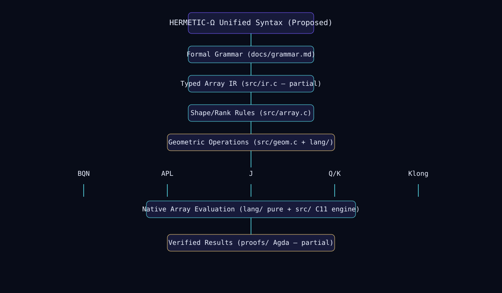

<p align="center">
  
</p>
<h1 align="center">HERMETIC-Ω</h1>
<p align="center">A Unified Recursive Geometric Array Language</p>
<p align="center">BQN · APL · J · Q/K · Klong</p>
<p align="center">Pure Arrays. Geometric Algebra. Deterministic Transformation.</p>

## 1. Research Summary

HERMETIC-Ω (also styled HAΩ) is an experimental research repository exploring a single coherent geometric array calculus that draws from BQN, APL, J, Q/K, and Klong. The computational substrate is array transformations, group actions, and manifold evolution rather than dense matrix materialization where avoidable.

**Current evidence base (as of this commit):**
- C11 array engine with explicit ownership, bounds checks, cache-aligned pool allocator, and 4-wide unrolled pointer-arithmetic kernels (`src/array.c`, `src/geom.c`).
- Pure array-language geometric definitions in BQN, APL, J, Klong, and Q (`lang/`).
- Partial Agda formalizations of shape contracts, sphere exponential map, and unit-norm preservation (`proofs/`).
- Minimal parser and IR skeletons (`src/parser.c`, `src/ir.c`).
- AGPLv3 license.

Nothing in this document claims a complete unified interpreter, full formal verification of all operators, or measured performance numbers. Proposed components are labeled Proposed.

## 2. Language Origins and Design Philosophy

The design inherits:
- From BQN: explicit trains, modifiers, rank polymorphism, structural manipulation.
- From APL: rich primitives, axis-aware operations, inner/outer products, grade.
- From J: tacit composition and rank conjunctions.
- From Q/K: compact vector evaluation and recursive functional style.
- From Klong: lightweight recursion and array-oriented higher-order expressions.

Collisions are resolved by a single canonical meaning per glyph or textual name. See `docs/compatibility.md` and `lang/glyph_registry.bqn`.

The goal is one evaluation model, not five interpreters glued together.

## 3. Mathematical Foundations

Unit sphere:
\[
S^n = \{ x \in \mathbb{R}^{n+1} : \|x\| = 1 \}
\]

Sphere exponential map (implemented in `src/geom.c` and `lang/sphere.bqn`):
\[
\operatorname{Exp}_x(v) = \cos(\|v\|)\, x + \operatorname{sinc}(\|v\|)\, v
\]
with continuous zero case via Taylor expansion of sinc. Preconditions: \(\|x\| = 1\) and \(x \cdot v = 0\).

Special orthogonal group:
\[
\operatorname{SO}(n) = \{ Q \in \mathbb{R}^{n \times n} : Q^T Q = I,\ \det(Q) = 1 \}
\]

Orthogonal invariance:
\[
\|Q x\|^2 = \|x\|^2
\]

Recursive geometric state:
\[
G_{n+1} = \Phi(G_n)
\]
where \(\Phi\) is a pure function preserving declared invariants (unit norm, tangency, shape).

Geometric product (simplified 3D form in `src/geom.c` and `lang/ga.bqn`):
\[
ab = a \cdot b + a \wedge b
\]

## 4. Unified Syntax and Formal Grammar

Canonical EBNF is recorded in `docs/grammar.md`. Every accepted program is required to have exactly one parse. The current parser (`src/parser.c`) is a minimal recursive-descent skeleton for atoms and array literals; full trains, modifiers, and geometry expressions remain partial.

## 5. BQN, APL, J, Q/K, Klong Semantics

Pure implementations live under `lang/`:

- `lang/engine.bqn`, `lang/sphere.bqn`, `lang/ga.bqn`, `lang/types.bqn`, `lang/group.bqn`
- `lang/engine.apl`, `lang/operators.apl`, `lang/group.apl`, `lang/tensor.apl`
- `lang/engine.j`, `lang/recursion.j`
- `lang/engine.klong`, `lang/evolution.klong`, `lang/recursion.klong`
- `lang/q_engine.q`

These are native expressions using each language’s primitives. They are not a single shared interpreter.

**Native BQN example (from `lang/sphere.bqn`):**
```bqn
SphereExp ← {
  x ← ⊢
  v ← ⊣
  nv ← √ Norm v
  c ← Cos nv
  s ← Sinc nv
  c×x + s×v
}
```

**Native APL example (from `lang/operators.apl`):**
```apl
SphereExp ← {
  x ← ⍴
  v ← ⍵
  nv ← √+×v
  c ← 2○○¯1×nv
  s ← (1○¯¯1×nv)÷nv
  (c×x)+s×v
}
```

## 6. Hermetic Geometric Algebra

Implemented kernels (C11, zero external dependencies):
- Sphere exponential map with unit and tangency checks (`hao_array_sphere_exp`).
- Geodesic interpolation (`hao_geodesic`).
- Simplified geometric product and exterior product.
- Quaternion multiply and rotate.
- Group action (identity placeholder in current code).

Pure counterparts exist in `lang/ga.bqn` and related files.

## 7. Recursive Array Transformation Engine

Evolution operator:
\[
X_{n+1} = \operatorname{Exp}_{X_n}(\eta_n V_n)
\]

C11 implementation: `hao_evolve_sphere` in `src/array.c` (fuel-bounded steps, precondition checks, 4-wide unrolled loops).
Pure implementations: `lang/evolution.klong`, `lang/engine.bqn` Evolve, `lang/q_engine.q`.


The polygons are symbolic state representations only.

## 8. Type, Shape, Rank and Memory Invariants

- Rank- and shape-indexed arrays in the C engine.
- Explicit ownership and free paths.
- Cache-line aligned bump pool (`hao_pool_init`, `aligned_alloc`).
- Bounds checks on every indexed access.
- Memory accounting: current bytes, peak, allocation count, pool usage (`hao_memory_report`).

Agda sketches in `proofs/Array.agda`, `proofs/Type.agda` track shape preservation and refinements. These are not complete machine-checked proofs of the C implementation.

## 9. Geometric Operators and Worked Examples

**Normalization (C11 path):**
```c
HaoArray *nrm = hao_norm(a);
double nv = ((double *)nrm->data)[0];
HaoArray *out = hao_normalize(a);
```

**Sphere exp test (from `tests/test_sphere.c`):**
Unit vector \(x = (1,0,0)\), small tangent \(v = (0,0.1,0)\). Post-condition: final norm ≈ 1 within 1e-8.

**Dot product / inner:**
`hao_inner` uses 4-wide unrolled pointer arithmetic.

Shape errors return NULL or negative codes; they are not silently ignored.

## 10. Compiler Architecture and Language Integration

```
src/
  array.c / array.h     — core array representation, pool, structural ops
  geom.c / geom.h       — metric and geometric kernels
  parser.c / parser.h   — minimal parser
  ir.c / ir.h           — typed IR skeleton
  toolchain.c           — zero-dep dispatcher bridging to pure ops
  main.c                — entry point + memory report
lang/                   — pure BQN/APL/J/Klong/Q definitions
proofs/                 — Agda formalizations
tests/                  — C tests
docs/                   — grammar, compatibility, operators
```



The unified syntax and full elaborator are Proposed. The C11 engine and pure language files exist independently.

## 11. Formal Verification and Property Testing

Agda modules (`proofs/Sphere.agda`, `proofs/Operators.agda`) state unit-norm preservation and shape contracts. They are mathematical sketches, not yet connected to the C runtime by extraction or verified compilation.

C test: `tests/test_sphere.c` checks unit norm after exponential map.

Distinction:
- Mathematical claim: stated in Agda and comments.
- Machine-checked proof: partial / not complete.
- Runtime test: present for sphere exp.
- Unverified: full SO(n) closure, general GA, optimizer correctness.

## 12. Benchmarks and Reproducible Experiments

No benchmark numbers are claimed. Reproducible methodology would record interpreter version, hardware, shape, iteration count, and median. Measurements are not yet available.

## 13. Installation, Usage and Contribution

**Build (C11, zero external dependencies beyond libm):**
```bash
make
./hao "[1 0 0]"
```

Pool is initialized to 1 MiB. Memory report is printed on exit.

**Pure languages:** Run the files in `lang/` with the respective interpreters (BQN, Dyalog/GNU APL, J, Klong, Q).

Contribution: follow AGPLv3. Preserve deterministic failure modes and shape contracts. Do not introduce network dependencies or hidden state in pure operators.

## 14. References, Glossary and Provenance

- Master build prompts are preserved in the repository history and `MASTER_BUILD_PROMPT.md` (when present).
- License: GNU Affero General Public License v3 (`LICENSE`).
- Asset credits: `docs/ASSET-CREDITS.md`.
- No photographic assets are committed.

**Glossary**
- HAΩ / HERMETIC-Ω: the project name.
- Shape contract: element count and rank relations that must hold for an operator.
- Hermetic: deterministic, no undeclared external state or network.
- Proposed: specified but not fully implemented in the current tree.

**Status summary**
- Implemented: array representation, pool, geometric kernels (sphere exp, geodesic, GA stubs), pure language definitions, partial Agda, minimal parser/IR, tests.
- Partial: full grammar, complete type system, full formal proofs.
- Proposed: single unified interpreter, complete optimizer, full SO(n) and Clifford algebra.

This README documents the repository as it exists. It does not invent implementations or results.
